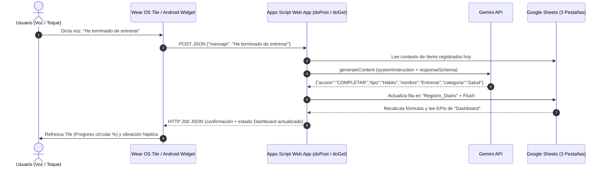

# Arquitectura de Integración: Google Sheets + Gemini + Android / Wear OS

Este documento detalla la especificación técnica para conectar la hoja de cálculo **"Gestor de Tareas y Hábitos"** con clientes móviles Android, relojes Wear OS y agentes mediante la Web App de Google Apps Script ([`Código.gs`](./Código.gs)) como pasarela Serverless segura.

---

## 1. Diagrama de Flujo de Arquitectura



---

## 2. Especificación de Llamadas HTTP contra la Web App

> **Nota crítica de red en Google Apps Script:** Todas las llamadas `POST` y `GET` a `https://script.google.com/macros/s/{DEPLOYMENT_ID}/exec` responden inicialmente con un código `HTTP 302 Moved Temporarily` hacia `script.googleusercontent.com`. El cliente HTTP (OkHttp/Retrofit en Kotlin, `curl -L` o `fetch`) debe tener habilitado `followRedirects = true` y `followSslRedirects = true`.

### 2.1. Caso A: Enviar un comando por voz (NLU con Gemini)
* **Método:** `POST`
* **URL:** `https://script.google.com/macros/s/{DEPLOYMENT_ID}/exec`
* **Headers:** `Content-Type: application/json; charset=utf-8`
* **Payload de Entrada:**
```json
{
  "mensaje": "Acabo de terminar de estudiar alemán y recuérdame comprar pilas",
  "token": "TU_TOKEN_OPCIONAL"
}
```

### 2.2. Caso B: Acción Directa desde un botón/checkbox en Wear OS Tile o Widget (Sin latencia de IA)
Cuando el usuario toca directamente una tarea pendiente en la pantalla del reloj para completarla sin dictar por voz:
* **Método:** `POST`
* **Payload de Entrada:**
```json
{
  "accionDirecta": {
    "accion": "COMPLETAR",
    "tipo": "Hábito",
    "nombre": "Meditar 10 min",
    "categoria": "Salud"
  },
  "token": "TU_TOKEN_OPCIONAL"
}
```

### 2.3. Caso C: Recuperar las métricas del `Dashboard` para pintar el Tile / Widget
Se puede invocar tanto por `GET` como por `POST`:
* **Opción 1 (`GET`):** `GET https://script.google.com/macros/s/{DEPLOYMENT_ID}/exec?token=TU_TOKEN_OPCIONAL`
* **Opción 2 (`POST`):**
```json
{
  "comando": "DASHBOARD",
  "token": "TU_TOKEN_OPCIONAL"
}
```

---

## 3. Formato del Payload de Respuesta (Estado y Métricas del Dashboard)

Tanto al ejecutar una orden (`doPost`) como al consultar el estado (`doGet`), Apps Script devuelve la estructura unificada `dashboard` para que el reloj o el widget repinten la interfaz en **una sola llamada de red**:

```json
{
  "ok": true,
  "accionEjecutada": "COMPLETAR",
  "ordenInterpretada": {
    "accion": "COMPLETAR",
    "tipo": "Hábito",
    "nombre": "Entrenar fuerza",
    "categoria": "Salud"
  },
  "filaAfectada": 18,
  "mensaje": "✅ \"Entrenar fuerza\" marcado como Completado a las 2026-11-06 21:05:12.",
  "dashboard": {
    "fecha": "2026-11-06",
    "actualizadoEn": "2026-11-06T21:05:12+01:00",
    "hoy": {
      "total": 6,
      "completados": 4,
      "pendientesCount": 2,
      "porcentajeCumplimiento": 67,
      "pendientes": [
        {
          "idFila": 19,
          "tipo": "Hábito",
          "nombre": "Leer 20 páginas",
          "categoria": "Estudio"
        },
        {
          "idFila": 21,
          "tipo": "Tarea",
          "nombre": "Pagar factura luz",
          "categoria": "Finanzas"
        }
      ],
      "completadosLista": [
        {
          "tipo": "Hábito",
          "nombre": "Entrenar fuerza",
          "categoria": "Salud",
          "timestamp": "2026-11-06 21:05:12"
        }
      ],
      "porCategoria": {
        "Salud": { "total": 2, "completados": 2, "porcentaje": 100 },
        "Estudio": { "total": 2, "completados": 1, "porcentaje": 50 },
        "Hogar": { "total": 1, "completados": 1, "porcentaje": 100 },
        "Finanzas": { "total": 1, "completados": 0, "porcentaje": 0 }
      }
    },
    "vistaDashboard": [
      ["Métrica", "Valor"],
      ["Cumplimiento Hoy", "67%"],
      ["Cumplimiento Semanal", "82%"]
    ]
  }
}
```

---

## 4. Implementación Cliente en Android y Wear OS (Kotlin)

### 4.1. Cliente de Red (OkHttp + Coroutines)
```kotlin
package com.antigravity.habitos.data

import kotlinx.coroutines.Dispatchers
import kotlinx.coroutines.withContext
import okhttp3.MediaType.Companion.toMediaType
import okhttp3.OkHttpClient
import okhttp3.Request
import okhttp3.RequestBody.Companion.toRequestBody
import org.json.JSONObject
import java.util.concurrent.TimeUnit

class GestorHabitosClient(
    private val webAppUrl: String,
    private val secretToken: String? = null
) {
    private val httpClient = OkHttpClient.Builder()
        .followRedirects(true)
        .followSslRedirects(true)
        .connectTimeout(15, TimeUnit.SECONDS)
        .readTimeout(20, TimeUnit.SECONDS)
        .build()

    private val jsonMediaType = "application/json; charset=utf-8".toMediaType()

    /**
     * Envía un comando dictado por voz desde el reloj o teléfono
     */
    suspend fun enviarComandoVoz(textoDictado: String): JSONObject = withContext(Dispatchers.IO) {
        val payload = JSONObject().apply {
            put("mensaje", textoDictado)
            if (!secretToken.isNullOrBlank()) put("token", secretToken)
        }
        ejecutarPost(payload)
    }

    /**
     * Completa un ítem directamente al tocar un chip en la tarjeta (Tile / Widget)
     */
    suspend fun completarItemDirecto(nombre: String, tipo: String = "Hábito", categoria: String = "General"): JSONObject =
        withContext(Dispatchers.IO) {
            val accionDirecta = JSONObject().apply {
                put("accion", "COMPLETAR")
                put("tipo", tipo)
                put("nombre", nombre)
                put("categoria", categoria)
            }
            val payload = JSONObject().apply {
                put("accionDirecta", accionDirecta)
                if (!secretToken.isNullOrBlank()) put("token", secretToken)
            }
            ejecutarPost(payload)
        }

    /**
     * Obtiene las métricas actuales del Dashboard para pintar el Tile de Wear OS y el Widget Glance
     */
    suspend fun obtenerDashboard(): JSONObject = withContext(Dispatchers.IO) {
        val payload = JSONObject().apply {
            put("comando", "DASHBOARD")
            if (!secretToken.isNullOrBlank()) put("token", secretToken)
        }
        ejecutarPost(payload)
    }

    private fun ejecutarPost(payload: JSONObject): JSONObject {
        val request = Request.Builder()
            .url(webAppUrl)
            .post(payload.toString().toRequestBody(jsonMediaType))
            .build()

        httpClient.newCall(request).execute().use { response ->
            val bodyStr = response.body?.string() ?: throw Exception("Respuesta vacía del servidor")
            if (!response.isSuccessful) {
                throw Exception("Error HTTP ${response.code}: $bodyStr")
            }
            return JSONObject(bodyStr)
        }
    }
}
```

### 4.2. Mapeo de Datos a la Tarjeta (Tile) de Wear OS y Widget de Android
* **Arco de Progreso (`CircularProgressIndicator` en Wear ProtoLayout):**
  Se alimenta directamente de `dashboard.hoy.porcentajeCumplimiento` (`0f..360f` convirtiendo `porcentaje * 3.6f`).
* **Texto Central del Reloj:**
  Muestra `"{completados}/{total}"` (ej. `4/6`) junto con `"Hoy: 67%"`.
* **Chips Interactivos (Top 2-3 Pendientes):**
  Se iteran los primeros elementos de `dashboard.hoy.pendientes`. Cada `Chip` dispara un `Action` que invoca `completarItemDirecto(item.nombre)` y llama a `TileService.getUpdater(context).requestUpdate(MiHabitosTileService::class.java)`.
* **Botón de Micrófono ("🎙️ Dictar"):**
  Abre `RecognizerIntent.ACTION_RECOGNIZE_SPEECH` en el reloj, captura el string reconocido, lo envía mediante `enviarComandoVoz(texto)` y actualiza el Tile con la respuesta devuelta.
