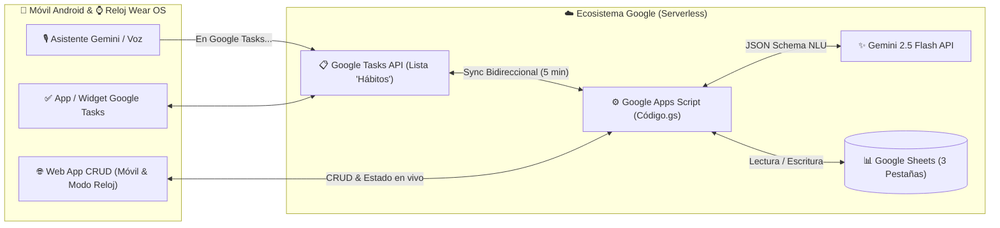

# ⚡ Gestor Inteligente de Tareas y Hábitos (Google Sheets + Gemini API + Google Tasks + Wear OS)

Sistema **Serverless y 100% gratuito** construido sobre el ecosistema de Google (**Google Sheets**, **Google Apps Script**, **Google Tasks API** y **Gemini 2.5 Flash**) para gestionar hábitos recurrentes y tareas diarias mediante:
1. **Comandos de voz en lenguaje natural** desde el móvil Android o reloj **Wear OS** (a través del asistente Gemini / Google Tasks).
2. **Interfaz Web Progresiva (PWA) con CRUD completo** en modo oscuro y **Modo Reloj AMOLED** integrado.
3. **Automatización nocturna** que genera cada madrugada los hábitos que tocan según su frecuencia (`Diaria`, `L-V`, `Fin de semana`, `Semanal`).

---

## ✨ Características Principales

* 🧠 **Motor NLU con Gemini 2.5 Flash:** Convierte frases naturales (ej. *"Ya he terminado de entrenar"*, *"Añade hábito diario meditar 10 minutos"*, *"Comprar pilas"*) en órdenes estructuradas JSON (`CREAR`, `COMPLETAR`, `BORRAR`, `CONSULTAR`) clasificadas automáticamente por categoría (`Salud`, `Estudio`, `Hogar`, `Mantenimiento`, `Finanzas`, `General`).
* 🔄 **Sincronización Bidireccional con Google Tasks:**
  * Publica automáticamente tus hábitos y tareas pendientes del día en una lista dedicada (`"Hábitos"`) en Google Tasks.
  * Al marcar el check `✓` desde el widget de Google Tasks en tu teléfono o reloj (o al pedírselo por voz al asistente), el script actualiza el estado a `Completado` con marca de tiempo (`YYYY-MM-DD HH:mm:ss`) en tu hoja de cálculo.
  * Incluye protección **anti-duplicados y anti-fantasmas**: ignora y limpia tareas completadas en días anteriores para no contaminar el progreso del día actual.
* 📱⌚ **Web App Adaptativa con CRUD Completo y Selector de Tema (`Dark` / `Light` / `System`):**
  * **Selector de visualización (`🌙 Oscuro` / `☀️ Claro` / `🖥️ Auto`):** Botón en la barra superior que alterna entre modo oscuro, modo claro y detección automática del tema del sistema operativo (`prefers-color-scheme`), recordando tu preferencia en el dispositivo.
  * **Pestaña `📅 Hoy`:** Anillo de progreso circular en vivo, progreso por categorías y lista interactiva para completar, reabrir, editar (`✏️`) o eliminar (`🗑️`) registros del día.
  * **Pestaña `⚙️ Catálogo Hábitos`:** Gestión directa de la hoja `Plantillas_Habitos` para crear nuevos hábitos recurrentes, editar su frecuencia/categoría, pausarlos temporalmente (`Activo` / `Pausado`) o eliminarlos.
  * **Modo Reloj (`?view=watch`):** Interfaz minimalista con fondo negro puro AMOLED optimizada para pantallas redondas o cuadradas de relojes inteligentes.
* 🔌 **API JSON / Webhook (`doPost` y `doGet`):** Preparada para integrarse con clientes nativos en Kotlin (Android Widgets / Wear OS Tiles) o herramientas de automatización.

---

## 🏗️ Arquitectura del Sistema

---

## 📊 Paso 1: Crear la Hoja de Cálculo en Google Sheets

1. Crea una nueva hoja de cálculo en tu Google Drive (por ejemplo, llamada **`Gestor de Tareas y Hábitos`**).
2. Crea exactamente **tres pestañas** en la parte inferior con la siguiente estructura de columnas en la **Fila 1**:

### 1️⃣ Pestaña `Plantillas_Habitos`
Catálogo maestro de hábitos recurrentes que se volcarán automáticamente cada noche si están activos y corresponde según su frecuencia.

| A: `ID` | B: `Nombre` | C: `Categoría` | D: `Frecuencia` | E: `Hora/Momento` | F: `Activo` |
| :--- | :--- | :--- | :--- | :--- | :--- |
| `H01` | Entrenar fuerza | Salud | L-V | Mañana | `TRUE` |
| `H02` | Leer 20 páginas | Estudio | Diaria | Noche | `TRUE` |
| `H03` | Revisar presupuesto | Finanzas | Semanal | Domingo | `TRUE` |
| `H04` | Limpieza general | Hogar | Fin de semana | Mañana | `TRUE` |

* **Valores admitidos en `Frecuencia`:** `Diaria`, `L-V` (Lunes a Viernes), `Fin de semana` (Sábado y Domingo), `Semanal` (por defecto Lunes, o indicando el día entre paréntesis como `Semanal (Miércoles)`).
* **Valores admitidos en `Activo`:** `TRUE` / `FALSE` (o casilla de verificación de Google Sheets).

---

### 2️⃣ Pestaña `Registro_Diario`
Bitácora histórica donde el script inserta cada día los hábitos correspondientes y las tareas puntuales.

| A: `Fecha` | B: `Tipo` | C: `Nombre` | D: `Categoría` | E: `Estado` | F: `Timestamp_Completado` |
| :--- | :--- | :--- | :--- | :--- | :--- |
| `2026-11-07` | Hábito | Entrenar fuerza | Salud | Completado | `2026-11-07 08:30:15` |
| `2026-11-07` | Hábito | Leer 20 páginas | Estudio | Pendiente | |
| `2026-11-07` | Tarea | Comprar pilas | Hogar | Pendiente | |

---

### 3️⃣ Pestaña `Dashboard`
Panel de control libre donde puedes colocar tus propios gráficos o fórmulas de resumen (`COUNTIFS`, `QUERY`, etc.) apuntando a `Registro_Diario`.

---

## ⚙️ Paso 2: Instalar y Configurar Google Apps Script

### 2.1. Copiar el código fuente
1. En tu hoja de Google Sheets, abre el menú superior **Extensiones > Apps Script**.
2. Ponle un nombre al proyecto arriba a la izquierda (por ejemplo, `Motor Gestor de Hábitos`).
3. Borra el contenido de `Código.gs` y pega íntegramente el código del archivo [`Código.gs`](./Código.gs) de este repositorio.
4. Pulsa el icono de **Guardar (`Ctrl + S`)**.

### 2.2. Activar el Servicio Avanzado `Google Tasks API`
Para que el script pueda sincronizarse con la app **Google Tasks** de tu móvil y reloj:
1. En la barra lateral izquierda del editor de Apps Script, haz clic en el símbolo **`+`** junto a **Servicios**.
2. Busca y selecciona **Google Tasks API**.
3. Asegúrate de que el identificador sea **`Tasks`** y pulsa **Añadir**.

### 2.3. Obtener y guardar tu API Key de Gemini
1. Entra en [Google AI Studio](https://aistudio.google.com/app/apikey) con tu cuenta de Google.
2. Haz clic en **Create API key** y copia la clave generada (`AIzaSy...`).
   > 🔒 **Nota de seguridad:** Nunca pegues tu API Key directamente dentro del código fuente. El script incluye un sistema seguro que la almacena en el contenedor privado `PropertiesService` de tu cuenta.
3. Vuelve a tu hoja de cálculo de Google Sheets y **recarga la página (`F5`)**.
4. Aparecerá en la barra superior el menú **`⚡ Mi Gestor`**.
5. Haz clic en **`⚡ Mi Gestor` > `🔑 Configurar Gemini API Key`**.
6. La primera vez, Google te pedirá **Autorizar permisos**: pulsa *Continuar > Selecciona tu cuenta > Configuración avanzada > Ir a proyecto > Permitir*.
7. Vuelve a pulsar **`⚡ Mi Gestor` > `🔑 Configurar Gemini API Key`**, pega tu clave y dale a **Aceptar**.

### 2.4. Activar los Disparadores Automáticos (Triggers)
1. En el menú superior de tu hoja de cálculo, haz clic en:
   **`⚡ Mi Gestor` > `⏰ Activar automatización total (00:05 + Sync cada 5 min)`**
2. Esto dejará programados automáticamente dos procesos en segundo plano:
   * **Volcado nocturno (00:05 AM):** Lee tus `Plantillas_Habitos`, inserta en `Registro_Diario` los que tocan ese día y los envía a tu lista `"Hábitos"` de Google Tasks.
   * **Sincronización continua (cada 5 minutos):** Revisa si has completado o dictado algo nuevo en Google Tasks desde el móvil o reloj y actualiza la hoja.

---

## 🌐 Paso 3: Desplegar la Interfaz Web (PWA Móvil y Reloj)

1. En el editor de **Apps Script**, pulsa el botón azul **Implementar > Nueva implementación** (arriba a la derecha).
2. Haz clic en el icono de engranaje ⚙️ junto a *"Selecciona el tipo"* y elige **Aplicación web**.
3. Configura los campos así:
   * **Descripción:** `Web App Gestor v1`
   * **Ejecutar como:** `Yo` (tu cuenta).
   * **Quién tiene acceso:** `Cualquier persona` *(o solo tú si únicamente vas a abrirla en navegadores donde tengas tu sesión de Google iniciada)*.
4. Pulsa **Implementar** y copia la **URL de la aplicación web** (`https://script.google.com/macros/s/TU_ID_DE_DESPLIEGUE/exec`).

### Modos de uso de tu URL desplegada:
* **📱 En el Móvil (PWA con CRUD):** Abre la URL en Chrome para Android, toca el menú `⋮` y selecciona **"Añadir a pantalla de inicio"**. Podrás ver tu anillo de progreso diario, marcar tareas y usar el botón **`＋ Nuevo Hábito / Tarea`** o la pestaña **`⚙️ Catálogo Hábitos`** para crear, editar, pausar o borrar hábitos.
* **⌚ En el Reloj (Modo Wear OS AMOLED):** Añade `?view=watch` al final de tu URL (`.../exec?view=watch`) o toca el botón `⌚` de la esquina superior derecha. La interfaz se adapta a pantallas diminutas con fondo negro puro.
* **🔌 Como API JSON:** Añade `?format=json` al final de tu URL (`.../exec?format=json`) para obtener el estado del Dashboard en formato JSON.

> 💡 **Importante al actualizar el código:** Si en el futuro modificas `Código.gs`, recuerda ir a **Implementar > Gestionar implementaciones > Editar (✏️) > Versión: "Nueva versión" > Implementar** para que los cambios se reflejen en la URL pública.

---

## 🗣️ Paso 4: Guía de Comandos de Voz con Gemini (Móvil y Reloj)

### Preparación recomendada en tu teléfono:
1. Instala la app oficial **Google Tasks** y coloca la lista **`"Hábitos"`** (que el script crea automáticamente) en **primera posición**.
2. En la app **Gemini** de tu móvil (*Perfil > Extensiones*), verifica que la extensión **Google Workspace / Google Tasks** esté activada.

> ⚠️ **Regla de Oro al hablar con Gemini:** Incluye siempre las palabras ***"en Google Tasks"*** dentro de tu orden de voz. Si dices solo *"en mi lista Hábitos"*, el asistente de Google puede interpretarlo como una nota de *Google Keep*.

### Ejemplos prácticos de comandos por voz:

| Acción deseada | Qué decirle a Gemini en el Móvil o Reloj | Resultado en tu Google Sheet |
| :--- | :--- | :--- |
| **Completar un hábito/tarea** | *"En Google Tasks, marca como completada **Entrenar fuerza**"* | Cambia el estado de `"Entrenar fuerza"` de hoy a `Completado` y anota fecha y hora en `Registro_Diario`. |
| **Completar dictando orden** | *"En Google Tasks, añade la tarea: **Ya he leído 20 páginas**"* | Gemini detecta la intención `COMPLETAR`, busca `"Leer 20 páginas"` hoy y lo marca como `Completado`. |
| **Crear una Tarea puntual (solo hoy)** | *"En Google Tasks, añade la tarea: **Pagar factura de la luz**"* | Inserta `"Pagar factura de la luz"` en `Registro_Diario` con `Tipo: Tarea`, `Categoría: Finanzas` y `Estado: Pendiente`. |
| **Crear un Hábito recurrente nuevo** | *"En Google Tasks, añade la tarea: **Hábito diario 20 minutos audio italiano**"* | 1. Registra `"20 minutos audio italiano"` en `Plantillas_Habitos` con frecuencia `Diaria` y categoría `Estudio`. 2. Lo añade también para hoy en `Registro_Diario`. |
| **Crear Hábito de Lunes a Viernes** | *"En Google Tasks, añade la tarea: **Hábito lunes a viernes meditar 10 minutos**"* | Lo da de alta en `Plantillas_Habitos` con frecuencia `L-V` y categoría `Salud`. |
| **Eliminar una tarea de hoy** | *"En Google Tasks, añade la tarea: **Borra comprar pilas**"* | Elimina la fila correspondiente de hoy en `Registro_Diario` y la quita de Google Tasks. |

---

## 📁 Estructura del Repositorio

* [`Código.gs`](./Código.gs): Código fuente completo de Google Apps Script (Menú en Sheets, cliente Gemini 2.5 Flash con JSON Schema, sincronización bidireccional con Google Tasks, triggers automáticos y Web App HTML/CSS/JS con CRUD y modo reloj).
* [`ARQUITECTURA_ANDROID_WEAROS.md`](./ARQUITECTURA_ANDROID_WEAROS.md): Documentación técnica del contrato de red HTTP (`doPost` / `doGet`), estructura de payloads JSON y ejemplo de cliente en Kotlin (`OkHttp` + `Coroutines`) para desarrolladores que deseen compilar un Widget nativo en Android Studio o un Tile en Wear OS.

---

## 📄 Licencia

Este proyecto es de código abierto y puedes adaptarlo libremente para tu uso personal o profesional.
